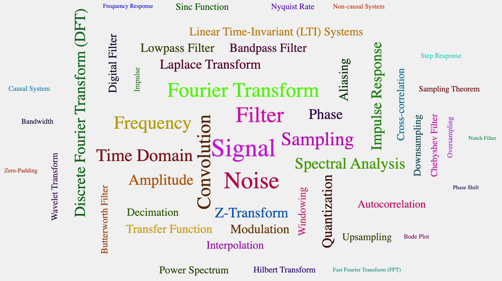

# About the Signal Processing with AI Website



This website is designed as a proof-of-concept site to help both instructors and students who are interested in learning about how AI can be used to teach signal processing.  

!!! Warning
    This is not a complete course on signal processing.  It is a course
    that helps instructors and students learn how to use generative AI
    tools to create content in a signal processing course.

This
website uses generative AI to create content around a learning graph and encourages both instructors
and students to use generative AI to create and modify
content such as simulations and animations of signal processing
concepts.

We have used the following workflow to generate much of this website.

<iframe src="../sims/book-gen-workflow/main.html" height="652px" scrolling="no"
  style="overflow: hidden;"></iframe>

You can hover various items to see what tasks they execute.

## Version 1: A Proof of Concept

Version 1 of this book was built to demonstrate a **proof of concept** for the
paper
[Deploying AI for Signal Processing education: Selected challenges and intriguing opportunities](https://arxiv.org/abs/2509.08950)
by Jarvis Haupt, Qin Lu, Yanning Shen, Jia Chen, Yue Dong, Dan McCreary,
Mehmet Akçakaya, and Georgios B. Giannakis (arXiv:2509.08950, September 2025).

The paper explores how generative AI tools such as large language models and
coding assistants can support signal processing education, and it illustrates
those ideas through the concept of a "smart textbook." This website is a
working example of that concept: a learning graph, AI-generated chapters,
and interactive MicroSims, all created with the workflow shown above.

### Key References

The following two versions of the paper are the key references for how this
book was created:

1. Haupt, J., Lu, Q., Shen, Y., Chen, J., Dong, Y., McCreary, D., Akçakaya, M.,
   & Giannakis, G. B. (2025). *Deploying AI for Signal Processing education:
   Selected challenges and intriguing opportunities*. arXiv:2509.08950.
   [https://arxiv.org/abs/2509.08950](https://arxiv.org/abs/2509.08950)
2. Haupt, J., Lu, Q., Shen, Y., Chen, J., Dong, Y., McCreary, D., Akçakaya, M.,
   & Giannakis, G. B. (2026). Deploying AI for Signal Processing education:
   Selected challenges and intriguing opportunities.
   *IEEE Signal Processing Magazine*, 43(1), 32–46.
   Special Issue on Artificial Intelligence for Education: A Signal Processing
   Perspective. Published 18 February 2026.
   DOI: [10.1109/MSP.2025.3600846](https://doi.org/10.1109/MSP.2025.3600846).
   [IEEE Xplore](https://ieeexplore.ieee.org/document/11398800)

## What is Signal Processing?

**Signal Processing** is the analysis, manipulation, and interpretation of signals to extract meaningful information, enhance signal quality, or transform signals into more useful forms.

### Core Definition

Signal processing involves mathematical and computational techniques applied to time-varying data (signals) such as audio, video, sensor measurements, or communication data. The field encompasses both analog and digital methods for filtering, amplifying, modulating, compressing, and analyzing signals to achieve specific objectives like noise reduction, feature extraction, or data compression.

### Key Characteristics

**Input**: Raw signals from various sources (microphones, cameras, sensors, antennas)

**Processing**: Mathematical operations including filtering, transformation, correlation, and statistical analysis

**Output**: Enhanced, modified, or analyzed signals that serve specific applications

### Fundamental Applications

Signal processing is essential in telecommunications, audio/video systems, medical imaging, radar, control systems, and data analysis. Common operations include removing unwanted noise from audio recordings, compressing images for storage, extracting features from sensor data, and converting analog signals to digital format for computer processing.

### Mathematical Foundation

The discipline relies heavily on concepts from linear algebra, calculus, probability theory, and Fourier analysis to represent signals in different domains (time, frequency, spatial) and apply appropriate transformations to achieve desired results.

## About the Author

{ width="150px" align="right"}

Dan McCreary is a semi-retired AI researcher, solution architect, and
educator who has spent more than three decades helping Fortune 100
organizations reason over massive datasets. At Optum he founded the
Generative AI Center of Excellence and led the team that built one of the
world's largest healthcare knowledge graphs — spanning over 25 billion
vertices — to unify member, provider, and patient insights. Dan's deep
background in knowledge representation and systems thinking underpins the
precise learning graphs and intelligent textbook workflows used throughout
this course.

He is the co-author of *Making Sense of NoSQL* (Manning Publications), the
founding chair of the NoSQL Now! conference, and a frequent keynote speaker
on semantic search, ontology strategy, and AI hardware. Beyond industry, Dan
has mentored students as a STEM volunteer since 2014 and now applies the same
rigor to building open educational resources. You can visit the
[Intelligent Textbooks Case Studies](https://dmccreary.github.io/intelligent-textbooks/case-studies/)
to see over 87 textbooks that Dan has created or co-created with other
authors.

**Selected Credentials**

- B.A. in Physics and Computer Science from Carleton College
- M.S.E.E. from the University of Minnesota
- MBA coursework at the University of St. Thomas
- Patent holder in semantic search and ontology management techniques
- Advocate for large-scale Enterprise Knowledge Graph adoption across
  healthcare and education
- Long-time promoter of accessible, low-cost AI-powered learning experiences

## Co-Authors of the Paper

The paper that Version 1 of this book was built to support was written by
a team of eight authors. The short bios below are summarized from the
[author biographies on IEEE Xplore](https://ieeexplore.ieee.org/document/11398800/authors#authors),
and titles and affiliations are those listed at the time of publication.

- **Jarvis Haupt** is an associate professor and associate department head in
  the Department of Electrical and Computer Engineering at the University of
  Minnesota. His research interests include statistical signal processing,
  machine learning, and optimization.
- **Qin Lu** is an assistant professor at the University of Georgia, which she
  joined in 2023 after a postdoctoral position at the University of Minnesota.
  She received her Ph.D. from the University of Connecticut in 2018, and her
  research interests include signal processing, machine learning, and
  communications.
- **Yanning Shen** is an associate professor in the Department of Electrical
  Engineering and Computer Science at the University of California, Irvine.
  Her research focuses on trustworthy machine learning and learning over
  graphs. She was selected as a Stanford Rising Star in EECS in 2017 and
  named one of MIT Technology Review's 35 Innovators Under 35 Asia Pacific
  in 2022.
- **Jia Chen** is an associate professor of teaching in the Department of
  Electrical and Computer Engineering at the University of California,
  Riverside. She received her Ph.D. in electrical engineering from the
  University of Texas at Arlington in 2016 and was a postdoctoral fellow at
  the University of Minnesota from 2017 to 2019.
- **Yue Dong** is an assistant professor of computer science at the University
  of California, Riverside. Her research covers controllable, trustworthy, and
  efficient large language models, with more than 40 papers at top natural
  language processing and machine learning venues.
- **Dan McCreary** is an AI education researcher who specializes in knowledge
  representation and in using learning graphs and large language models to
  create intelligent textbooks. He is an intelligent textbook consultant at
  Kelly-McCreary & Associates and holds an M.S.E.E. from the University of
  Minnesota. See [About the Author](#about-the-author) above for his full bio.
- **Mehmet Akçakaya** is the Jim and Sara Anderson Chair Professor in the
  Department of Electrical and Computer Engineering at the University of
  Minnesota, where he has been on the faculty since 2015. He received his
  Ph.D. from Harvard University, and his research interests include image
  processing, artificial intelligence, medical physics, inverse problems, and
  signal processing.
- **Georgios B. Giannakis** holds a Presidential Endowed Chair in the
  Department of Electrical and Computer Engineering at the University of
  Minnesota, where he has been since 1999 after time at the University of
  Virginia. He received his Ph.D. from the University of Southern California.
  His research interests include data science, signal processing,
  communications, and networking, and he has published more than 500 journal
  articles.

## How to Cite This Book

If you reference this textbook in academic work, curriculum proposals,
lesson plans, or other publications, please use one of the following
citation formats.

**APA (7th edition)**

McCreary, D. (2026). *Signal Processing with AI*. https://dmccreary.github.io/signal-processing/

**Chicago (17th edition)**

McCreary, Dan. 2026. *Signal Processing with AI*. https://dmccreary.github.io/signal-processing/.

**MLA (9th edition)**

McCreary, Dan. *Signal Processing with AI*. 2026, dmccreary.github.io/signal-processing/.

**BibTeX**

```bibtex
@book{mccreary2026signalprocessing,
  title     = {Signal Processing with AI},
  author    = {McCreary, Dan},
  year      = {2026},
  url       = {https://dmccreary.github.io/signal-processing/},
  note      = {Interactive intelligent textbook}
}
```

To cite a specific chapter, append the chapter number and title — for
example:

McCreary, D. (2026). Chapter 1: Mathematical Foundations. In
*Signal Processing with AI*. https://dmccreary.github.io/signal-processing/chapters/01-mathematical-foundations/

To cite the paper that Version 1 of this book was built to support, see the
[Key References](#key-references) above:
[arXiv:2509.08950](https://arxiv.org/abs/2509.08950) or the
[IEEE Signal Processing Magazine article](https://ieeexplore.ieee.org/document/11398800).

## License

This work is released under the
[Creative Commons Attribution-NonCommercial-ShareAlike 4.0 International
License (CC BY-NC-SA 4.0)](license.md). You are free to share and adapt the
material for non-commercial purposes as long as you give appropriate credit
and share your adaptations under the same license.

